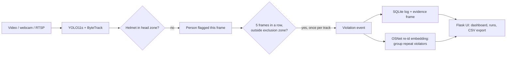

# Helmet Compliance: hard hat monitoring with YOLO11

Finds people without a hard hat on video files, webcams and RTSP cameras. A fine-tuned **YOLO11s** detects people and helmets; a person counts as a violator when no helmet is found in the top part of their box. Violations are confirmed over several frames, logged once per track, and shown in a Flask web UI with evidence frames, an exclusion zone and a journal that groups repeat violators with an OSNet re-identification model.

<!-- add a 5-10 s gif here: assets/demo.gif -->

## Why a rule instead of the no_helmet class

The model is trained on [Construction-PPE](https://docs.ultralytics.com/datasets/detect/construction-ppe/) (11 classes). It finds helmets and people well, but its own `no_helmet` class is weak (few examples):

| Class | AP50 (test, 141 images) |
|---|---|
| helmet | **0.951** |
| person | 0.812 |
| no_helmet | 0.164 |

So violations are derived from the strong classes: *person detected, no helmet in the top 35% of the box*. `tools/eval_violations.py` checks this on the labeled people of the test split (41 without a helmet, 160 with one; 35 people whose head is not labeled are skipped):

| Method | Recall | Precision | F1 | False alarms on people with a helmet |
|---|---|---|---|---|
| **Rule: person without helmet in head zone** (app default) | **0.90** | 0.64 | **0.75** | 4.4% |
| `no_helmet` class, same threshold (0.45) | 0.12 | 1.00 | 0.22 | 0% |
| `no_helmet` class, best threshold on test (0.15) | 0.66 | 0.84 | 0.74 | 1.3% |

The rule catches 37 of 41 violators; the 4 it misses are people the detector did not find at all. Even with its threshold tuned on the test set itself (an optimistic setup), the class finds about a quarter fewer violators (27 vs 37). Most of the rule's false alarms (14 of 21) are person boxes that don't match any labeled person: partly people the dataset leaves unlabeled, partly false person detections.

These are single-image numbers. In video the app additionally requires 5 consecutive frames without a helmet before logging, which removes one-frame flickers; this part is not measured, as there is no labeled video.

Full numbers: [docs/metrics_test.json](docs/metrics_test.json), [docs/violations_eval.json](docs/violations_eval.json). Plots: [training curves](docs/training_curves.png), [PR curve](docs/pr_curve_test.png), [confusion matrix](docs/confusion_matrix_test.png).

## Repeat violators: re-identification

The first version embedded head-and-shoulders crops with an ImageNet MobileNetV3. Measured on [Market-1501](https://zheng-lab-anu.github.io/Project/project_reid.html) (people and cameras none of the models were trained on), it almost never recognised anyone. It is now **OSNet x0.25 trained on MSMT17** (weights by the torchreid author), applied to the full person crop.

Two measurements (`tools/eval_reid.py`):

- **Standard protocol**: 3,368 queries against a 15,913-image gallery.
- **The journal as the app uses it**: 50 people in the journal; events are either a repeat violator seen by another camera or someone new. The match threshold is chosen on the Market-1501 *train* identities so that about 5% of new people get merged into an existing profile, then measured on the test identities.

| Embedding | Rank-1 | mAP | Repeat violator found | New person merged wrongly |
|---|---|---|---|---|
| MobileNetV3 ImageNet, head & shoulders (before) | 12.9% | 4.1% | 2.2% | 3.4% |
| MobileNetV3 ImageNet, full body | 14.1% | 4.3% | 4.0% | 4.6% |
| OSNet MSMT17, head & shoulders | 32.3% | 13.9% | 8.5% | 4.1% |
| OSNet MSMT17, full body | 60.1% | 33.7% | 26.0% | 4.8% |
| **OSNet, full body, 3 vectors per person (now)** | | | **37.8%** | 5.7% |

Both the model and the crop matter: the full body barely helps the ImageNet model, but doubles OSNet's accuracy, because legs and shoes carry a lot of identity. Keeping the last 3 embeddings per person (often from different cameras) adds another 12 points. On the test identities the threshold of 0.80 merges 5.7% of new people instead of the 5% targeted on train.

The threshold is deliberately strict: a missed match only creates a duplicate profile, while a wrong one blames someone else. With 200 people in the journal wrong merges rise to 17%, so on a large site the threshold should be raised. On one CPU core OSNet x0.25 embeds about 40 crops per second; OSNet x1.0 is more accurate but runs at under 2 per second, too slow for live cameras.

Full numbers for 20, 50 and 200 people: [docs/reid_eval.json](docs/reid_eval.json).

## How it works



- **Head zone rule** (`detector.py`): a helmet counts only if its center is in the top 35% of the person box, its confidence is at least 0.5 and it is not larger than half the person (a misdetection, not a hat on a head).
- **Events** (`monitor.py`): shared by file processing and live cameras. A track must stay without a helmet for 5 frames; each track is reported once. Without tracking, a frame streak plus a cooldown is used.
- **Exclusion zone**: a rectangle drawn in the browser (walkway, cabin) where people are not counted. The bottom center of the box, where the feet are, decides whether someone stands inside.
- **Repeat violators** (`person_db.py`, `reid.py`): the full person crop of each event is embedded with OSNet and matched against the last 3 embeddings of everyone seen in the last 30 days (cosine similarity ≥ 0.80). See the next section.

## Quick start

Python 3.10–3.12.

```bash
git clone https://github.com/sherzodbek-fozilov/helmet-compliance.git
cd helmet-compliance
python -m venv venv && source venv/bin/activate   # Windows: venv\Scripts\activate
pip install torch torchvision --index-url https://download.pytorch.org/whl/cu126   # or skip for cpu
pip install -r requirements.txt
```

Download `ppe_yolo11s.pt` from [Releases](../../releases) into `models/`, then:

```bash
python app.py                      # web ui at http://127.0.0.1:5000
python main.py --video site.mp4    # or process a file from the command line, --show for a preview window
```

The first run downloads the OSNet re-id weights (9 MB, [kaiyangzhou/osnet](https://huggingface.co/kaiyangzhou/osnet)) into `models/`. Without internet everything works except grouping repeat violators.

## Reproduce the numbers

```bash
python tools/evaluate.py --model models/ppe_yolo11s.pt --split test         # detection metrics
python tools/eval_violations.py --model models/ppe_yolo11s.pt --split test  # rule vs no_helmet class
python tools/eval_reid.py --market path/to/Market-1501-v15.09.15            # re-id comparison
python tools/train.py --epochs 80                                           # retrain (~75 min on a GTX 1650)
```

Construction-PPE (~180 MB) downloads automatically; Market-1501 has to be downloaded separately. Training stopped early at epoch 50 (best epoch 30, patience 20).

## Project structure

| Path | What it does |
|---|---|
| `detector.py` | YOLO wrapper, head zone rule, drawing |
| `monitor.py` | Per-frame flags → violation events (frame streak, once per track, exclusion zone) |
| `main.py` | File processing: annotated video, summary, chart, SQLite |
| `streaming.py` | Live sessions (webcam / RTSP / file) streamed to the browser as MJPEG |
| `app.py`, `templates/` | Flask UI |
| `event_logger.py` | Runs, events, per-track summaries, CSV export |
| `person_db.py`, `reid.py`, `osnet.py` | Repeat violator journal, OSNet embeddings |
| `tools/` | Training, detection / violation / re-id evaluation, frame extraction |

## Limitations

- **Precision 0.64 per image**: about one alarm in three is false on single images. The 5-frame confirmation reduces this in video, but by how much is not measured.
- **Re-id finds about 4 in 10 repeat violators**, and was measured on Market-1501 (a campus, everyday clothes). On a construction site, where everyone wears the same vest and helmet, people look more alike and accuracy will be lower. Fine-tuning OSNet on footage from the site itself would be the next step.
- People the detector misses are never checked (4 of 41 violators on the test set).
- Small test set: 141 images, 41 labeled violators, so the numbers have a wide margin of error.
- One live session at a time, rectangle-only exclusion zone, no authentication: a demo, not something to expose to the internet.

## License

AGPL-3.0, since the project builds on Ultralytics YOLO11 and the Construction-PPE dataset, both AGPL-3.0. `osnet.py` and the OSNet weights are from [torchreid](https://github.com/KaiyangZhou/deep-person-reid) (MIT).
